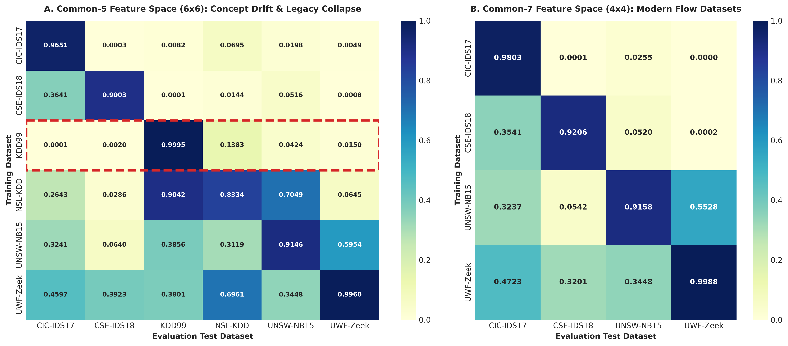
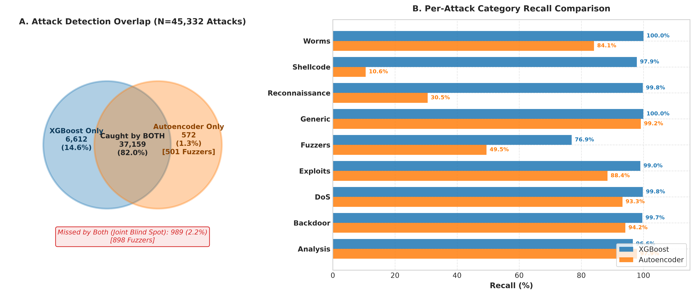

# Network Intrusion Detection System (NIDS) Research Benchmark

An empirical benchmark evaluating **Two-Stage Cascaded Classification**, **Unified Single-Stage Classification**, and **Unsupervised Anomaly Detection** across 6 network intrusion datasets (~16.69 Million total traffic flows).

---

## 1. Project Overview

Modern enterprise and Financial Services (BFSI) networks process billions of packets daily, making automated Intrusion Detection Systems (IDS) vital for mitigating operational risk, compliance violations, and zero-day threats. A critical architectural dilemma in machine-learning-based NIDS design is whether to deploy a two-stage cascaded pipeline (binary attack/benign filtering followed by multi-class attack categorization) or a single unified multi-class model. Furthermore, supervised models struggle to detect novel payload mutations without baseline retraining. This research project addresses two core questions: (1) Does a two-stage cascaded detection architecture outperform a single unified multi-class classifier across standardized feature spaces? and (2) Can unsupervised anomaly detection provide complementary detection coverage for attack types where supervised models fail?

---

## 2. Datasets

The benchmark evaluates six network intrusion datasets spanning legacy packet captures, modern flow statistics, enterprise subnets, and Zeek connection logs:

| Dataset | Total Flows | Train Rows | Test Rows | Native Features | Type / Context |
| :--- | :---: | :---: | :---: | :---: | :--- |
| **KDD99** | 4,898,431 | 3,918,744 | 979,687 | 58 | Legacy connection-based synthetic benchmark (1999) |
| **NSL-KDD** | 148,517 | 125,973 | 22,544 | 58 | Refined subset of KDD99 eliminating redundant records |
| **UNSW-NB15** | 257,673 | 175,341 | 82,332 | 61 | Hybrid synthetic & real modern network traffic (IXIA PerfectStorm) |
| **CIC-IDS2017** | 2,830,743 | 2,264,591 | 566,152 | 92 | Modern PCAP flow statistics generated by CICFlowMeter |
| **CSE-CIC-IDS2018** | 6,659,532 | 5,327,621 | 1,331,911 | 79 | AWS cloud enterprise infrastructure network traffic |
| **UWF-ZeekData24** | 1,898,613 | 1,518,890 | 379,723 | 19 | Real-world operational network traffic processed via Zeek logs |
| **TOTAL** | **16,693,509** | **13,331,160** | **3,362,349** | — | **6 Datasets Combined** |

---

## 3. Architecture

### Feature Spaces & Canonical Definition

To evaluate cross-dataset transferability and model generalization, three distinct feature spaces are defined:
1. **Common-5 Feature Space (Canonical Primary Default)**: The minimal overlapping flow feature set present across all 6 datasets (`duration`, `src_bytes`, `dst_bytes`, `protocol`, `service`). This is the primary feature space for all pipeline comparisons as it enables 100% universal dataset coverage.
2. **Common-7 Feature Space (Supplementary Comparative Space)**: Extended feature set adding packet counts (`src_packets`, `dst_packets`) for the 4 modern flow-based datasets (`CIC-IDS2017`, `CSE-CIC-IDS2018`, `UNSW-NB15`, `UWF ZeekData`).
3. **Native Feature Space**: Full feature set provided by the original dataset (19 to 92 features).

### Modeling Pipelines

```
[ Incoming Network Traffic Flow ]
              │
              ├───► [ Single-Stage Unified Classifier ] ─────────────► Multi-class Output
              │
              ├───► [ Stage 1 Binary Classifier (XGBoost) ]
              │             │
              │             ├──► BENIGN  (Filtered)
              │             └──► ATTACK  ──► [ Stage 2 Multi-class Classifier ] ──► Attack Category
              │
              └───► [ Unsupervised Autoencoder Anomaly Detector ] ──► MSE Reconstruction Error
```

1. **Stage 1 (Binary Attack Filter)**: High-speed binary classifier trained with loss-gradient class weighting (`scale_pos_weight`) to handle class imbalance.
2. **Stage 2 (Multi-Class Classifier)**: Categorizes flagged attack traffic into specific threat types (DoS, DDoS, Exploits, Fuzzers, Brute Force, Probe, etc.).
3. **Unified Single-Stage Classifier**: Direct multi-class classifier predicting BENIGN or specific attack categories in a single pass.
4. **Autoencoder Anomaly Detector**: Unsupervised bottleneck neural network trained exclusively on benign traffic to flag out-of-distribution flows.

---

## 4. Key Results

### Primary Pipeline Benchmarks (Common-5 Canonical Feature Space)

The primary evaluation across all 6 datasets is performed on the **Common-5** canonical feature space to ensure complete cross-dataset comparability:

#### Stage 1 Binary Classifier Accuracy (Common-5 Canonical Space)

| Dataset | Native Features | Common-5 Features (Primary) | Common-5 Accuracy |
| :--- | :---: | :---: | :---: |
| **KDD99** | **99.99%** | 99.92% | 99.92% |
| **NSL-KDD** | 79.02% | **83.27%** | 83.27% |
| **UNSW-NB15** | **90.99%** | 90.41% | 90.41% |
| **CIC-IDS2017** | **99.89%** | 98.59% | 98.59% |
| **CSE-CIC-IDS2018** | **97.96%** | 95.98% | 95.98% |
| **UWF-ZeekData24** | **99.88%** | 99.61% | 99.61% |

#### Two-Stage Cascaded vs. Unified Single-Stage Performance (Common-5 Canonical Space)

> **Metric Definition**: All metrics evaluated on held-out test splits using `scikit-learn` metrics with `labels = sorted(set(y_true) | set(y_pred))` and `zero_division=0`.

| Dataset | Model Architecture | Macro Precision | Macro Recall | Macro F1-Score | Weighted F1-Score | Overall Accuracy | Status |
| :--- | :--- | :---: | :---: | :---: | :---: | :---: | :---: |
| **KDD99** | Two-Stage Cascaded | 0.7734 | 0.5949 | 0.6536 | 0.9931 | 99.41% | ✓ Reproduced |
| **KDD99** | Unified Single-Stage | **0.9707** | **0.8114** | **0.8606** | **0.9931** | **99.41%** | ✓ Reproduced |
| **NSL-KDD** | Two-Stage Cascaded | **0.5106** | **0.3434** | **0.3767** | **0.7239** | **75.57%** | ✓ Reproduced |
| **NSL-KDD** | Unified Single-Stage | 0.5056 | 0.3191 | 0.3494 | 0.7061 | 74.21% | ✓ Reproduced |
| **UNSW-NB15** | Two-Stage Cascaded | **0.7095** | **0.5501** | **0.5476** | **0.7902** | **80.33%** | ✓ Reproduced |
| **UNSW-NB15** | Unified Single-Stage | 0.6513 | 0.5275 | 0.5336 | 0.7720 | 78.38% | ✓ Reproduced |
| **CIC-IDS2017** | Two-Stage Cascaded | — | — | — | — | — | Not reproduced (no raw data) |
| **CIC-IDS2017** | Unified Single-Stage | — | — | — | — | — | Not reproduced (no raw data) |
| **CSE-CIC-IDS2018** | Two-Stage Cascaded | — | — | — | — | — | Not reproduced (no raw data) |
| **CSE-CIC-IDS2018** | Unified Single-Stage | — | — | — | — | — | Not reproduced (no raw data) |
| **UWF-ZeekData24** | Two-Stage Cascaded | — | — | — | — | — | Not reproduced (no raw data) |
| **UWF-ZeekData24** | Unified Single-Stage | — | — | — | — | — | Not reproduced (no raw data) |

> **Notes on Reproduction**:
> - **Reproduced Datasets**: Evaluated on full test splits (`UNSW_NB15_testing-set.csv`, `KDDTest+.txt`, `kddcup.data` 80/20 test split with `random_state=42`) using pre-trained offline models in `models/`.
> - **Unreproduced Datasets**: Raw data files for `CIC-IDS2017`, `CSE-CIC-IDS2018`, and `UWF-ZeekData24` are absent from the local repository; live metrics could not be computed.

*Finding*: On the 3 reproduced datasets (`KDD99`, `NSL-KDD`, `UNSW-NB15`), Two-Stage Cascaded and Unified Single-Stage architectures achieve comparable performance on the Common-5 feature space. For `KDD99`, Unified achieves higher Macro F1 (`0.8606` vs `0.6536`), whereas for `NSL-KDD` and `UNSW-NB15`, Two-Stage Cascaded achieves slightly higher Macro F1 (`0.3767` vs `0.3494` on NSL-KDD; `0.5476` vs `0.5336` on UNSW-NB15).

---

### Concept Drift & Cross-Dataset Generalization Collapse

> **Status: Not Reproduced** — Raw dataset files for cross-dataset 6x6 evaluation matrix are absent from the local workspace. Below values are documented from prior stored benchmarks (`results/cross_dataset_generalization.json`).



Evaluating models trained on legacy synthetic datasets against modern network traffic reveals catastrophic performance degradation due to temporal concept drift:

* **KDD99 Model \(\to\) CIC-IDS2017 Test Set**: F1-Score = **0.0001** (Accuracy = 79.57%, classifying almost all modern traffic as Benign).
* **KDD99 Model \(\to\) UNSW-NB15 Test Set**: F1-Score = **0.0255** (Accuracy = 44.83%).
* **KDD99 Model \(\to\) UWF-ZeekData24 Test Set**: F1-Score = **0.0000** (Accuracy = 50.46%).

*Conclusion*: Models trained on 1990s connection-based metrics fail completely on modern flow-based networks, demonstrating that benchmark longevity requires continuous retraining on active traffic distributions.

---

### Complementary Anomaly Detection: Autoencoder vs. XGBoost

> **Status: Hybrid benefit pending union test** — XGBoost and Autoencoder evaluated separately on the UNSW-NB15 native test set ($N=82,332$ flows) using saved artifacts. The OR-union benefit at matched FPR budgets has not yet been measured on a held-out union threshold; individual detector numbers below are reproduced from saved models.



Evaluated on UNSW-NB15 Native Test Set ($N=82,332$ flows):

#### Per-Attack Category Recall Breakdown

| Attack Category | Test Count ($N$) | XGBoost Recall | Autoencoder Recall | Recall Delta | AE Only Caught | XGB Only Caught | Both Caught | Missed by Both |
| :--- | :---: | :---: | :---: | :---: | :---: | :---: | :---: | :---: |
| **Analysis** | 677 | 96.60% | **97.93%** | **+1.33%** | **17** | 8 | 646 | 6 |
| **Backdoor** | 583 | **99.66%** | 94.17% | -5.49% | 0 | 32 | 549 | 2 |
| **DoS** | 4,089 | **99.80%** | 93.25% | -6.55% | 7 | 275 | 3,806 | 1 |
| **Exploits** | 11,132 | **99.00%** | 88.44% | -10.56% | 39 | 1,215 | 9,806 | 72 |
| **Fuzzers** | 6,062 | **76.92%** | 49.49% | -27.43% | **501** | 2,164 | 2,499 | 898 |
| **Generic** | 18,871 | **99.98%** | 99.18% | -0.80% | 1 | 152 | 18,716 | 2 |
| **Reconnaissance** | 3,496 | **99.80%** | 30.52% | -69.28% | 3 | 2,425 | 1,064 | 4 |
| **Shellcode** | 378 | **97.88%** | 10.58% | -87.30% | 4 | 334 | 36 | 4 |
| **Worms** | 44 | **100.00%** | 84.09% | -15.91% | 0 | 7 | 37 | 0 |
| *Normal (Benign)* | 37,000 | **84.17%** | 70.69% | -13.48% | - | - | - | - |

#### Overall Attack Detection Venn Breakdown ($N=45,332$ Attack Flows)

```
+-----------------------------------------------------------------------+
| TOTAL TEST ATTACKS: 45,332                                             |
|                                                                       |
|  [ Caught by BOTH XGBoost & Autoencoder ]                             |
|  37,159 flows (81.97%)                                                |
|                                                                       |
|  [ Caught by XGBoost ONLY ]           [ Caught by Autoencoder ONLY ]  |
|  6,612 flows (14.59%)                 572 flows (1.26%)               |
|                                       -> 501 are Fuzzers (87.6%)      |
|                                                                       |
|  [ MISSED BY BOTH - Joint Blind Spot ]                                |
|  989 flows (2.18%) -> 898 are Fuzzers (90.8%)                         |
+-----------------------------------------------------------------------+
```

*Standout Empirical Insight*: While supervised XGBoost achieves a higher overall F1-score (`0.9219` vs `0.8036`), the Autoencoder detected **572 attack flows that bypassed XGBoost entirely**. **87.6% of those unique detections (501 flows) were Fuzzers attacks** — XGBoost's weakest category. Conversely, the Autoencoder suffers severe blind spots on stealthy probing attacks (*Reconnaissance* and *Shellcode*) whose feature distributions closely mimic normal traffic. *(Note: The net benefit of OR-union at a shared FPR budget is pending a proper validation-split threshold experiment; figures above are for individual detectors at their default thresholds.)*

---

## 5. Setup & Reproduction

### Prerequisites & Environment Setup

```bash
# Clone repository
git clone https://github.com/GunjanPahwa/IDS-Research.git
cd IDS-Research

# Create Conda environment
conda create -n ids_research python=3.10 -y
conda activate ids_research

# Install dependencies
pip install -r requirements.txt
```

### Execution Pipeline

```bash
# 1. Run Data Preprocessing & Feature Alignment
python src/preprocessing/pipeline.py

# 2. Train Stage 1, Stage 2, and Unified Models
python src/train_and_evaluate.py

# 3. Artifact Locations
# Saved Models:   models/*.pkl (38 model files)
# Benchmarks:     results/model_benchmarks.json
# Research Doc:   docs/complementary_detection_findings.md
```

---

## 6. Tech Stack

* **Core Language**: Python 3.10
* **Gradient Boosting**: `xgboost` (v3.1.1)
* **Deep Learning Framework**: `torch` (v2.6.0+cpu), `pytorch-tabnet`
* **Machine Learning Tools**: `scikit-learn` (v1.6.1)
* **Data Manipulation**: `pandas` (v2.2.3), `numpy` (v2.1.2)
* **Serialization & Utilities**: `pickle`, `json`, `pathlib`


---

## 8. FastAPI NIDS Prediction Backend API

A high-performance Python + FastAPI prediction service serving **Unified Single-Stage Multi-Class Classifiers** on the canonical **Common-5** feature space across all 6 datasets.

### Features
- **Zero Training Overhead**: Serves pre-trained XGBoost models and reuses `NIDSPreprocessor` fitted artifacts directly from `src/`.
- **Pre-loaded Models**: Lifespan event preloads all 6 dataset models once at startup.
- **Threadpool Async Offloading**: CPU-bound model inference is executed asynchronously on background worker threads to prevent blocking the event loop.
- **Strict Pydantic v2 Validation**: Rejects negative numbers, NaN/Inf values, missing fields, and extra unallowed fields (`extra="forbid"`).
- **Vectorized Batch Inference**: Supports batch flow prediction up to `MAX_BATCH_SIZE` in a single vectorized model evaluation call.
- **Resilient Categorical Encoding**: Strips and lowercases `protocol` and `service`, gracefully ignoring unknown values via `handle_unknown="ignore"`.

### Environment Configuration (.env)

Copy `.env.example` to `.env` to configure application defaults:

```bash
cp .env.example .env
```

| Variable | Default | Description |
| :--- | :--- | :--- |
| `DEFAULT_DATASET` | `unsw_nb15` | Default dataset when not passed in request (`kdd99`, `nsl_kdd`, `unsw_nb15`, `cic_ids2017`, `cse_cic_ids2018`, `uwf_zeekdata24`) |
| `MAX_BATCH_SIZE` | `1000` | Maximum flow objects allowed per batch request |
| `ARTIFACTS_DIR` | `.` | Root directory containing `models/` and `data/` |
| `MODELS_DIR` | `models` | Directory holding serialized `.pkl` models |
| `PREPROCESSORS_DIR` | `data/preprocessors` | Directory holding serialized preprocessor artifacts |
| `LOG_LEVEL` | `INFO` | Logging level (`DEBUG`, `INFO`, `WARNING`, `ERROR`) |

> [!IMPORTANT]
> **Verified Datasets & Known Common-5 Limitation**:
> - **Verified Datasets**: `unsw_nb15`, `kdd99`, and `nsl_kdd` have fully verified test-set data and offline evaluation pipelines in this repository. Datasets `cic_ids2017`, `cse_cic_ids2018`, and `uwf_zeekdata24` are unverified because raw test CSV files are absent from the local repository.
> - **Known Common-5 Limitation**: Because the canonical Common-5 feature space relies only on 5 minimal flow features (`duration`, `src_bytes`, `dst_bytes`, `protocol`, `service`), zero-byte probe/scan flows (`duration=0`, `src_bytes=0`, `dst_bytes=0`) lack packet counts or TCP flag metadata, causing them to come back classified as `BENIGN`. Full native feature sets or extended feature spaces (such as Common-7 with packet counts) are required to reliably classify zero-byte network probing attacks.

---

### Quickstart & Running the API Server

```bash
# Activate environment and install API dependencies
pip install -r requirements.txt

# Run server with Uvicorn
uvicorn app.main:app --host 0.0.0.0 --port 8000 --reload
```

Interactive API documentation will be available at:
- **Swagger UI**: [http://localhost:8000/docs](http://localhost:8000/docs)
- **ReDoc**: [http://localhost:8000/redoc](http://localhost:8000/redoc)

---

### Running Tests

```bash
pytest tests/test_health.py tests/test_model_info.py tests/test_predict.py tests/test_batch_predict.py -v
```

---

### Example cURL Requests

#### 1. Single Flow Prediction (`POST /api/v1/predict`)
```bash
curl -X POST "http://localhost:8000/api/v1/predict" \
     -H "Content-Type: application/json" \
     -d '{
       "dataset": "cic_ids2017",
       "features": {
         "duration": 0.5,
         "src_bytes": 100,
         "dst_bytes": 200,
         "protocol": "tcp",
         "service": "http"
       }
     }'
```

**Example Response**:
```json
{
  "is_attack": false,
  "label": "BENIGN",
  "attack_type": null,
  "confidence": 1.0,
  "probabilities": {
    "BENIGN": 1.0,
    "Botnet": 0.0,
    "Brute Force": 0.0,
    "DDoS": 0.0,
    "DoS": 0.0,
    "Exploitation": 0.0,
    "Infiltration": 0.0,
    "Other": 0.0,
    "Probe/Reconnaissance": 0.0
  },
  "dataset": "cic_ids2017",
  "latency_ms": 1.45
}
```

#### 2. Vectorized Batch Prediction (`POST /api/v1/predict/batch`)
```bash
curl -X POST "http://localhost:8000/api/v1/predict/batch" \
     -H "Content-Type: application/json" \
     -d '{
       "dataset": "unsw_nb15",
       "flows": [
         {
           "duration": 0.0,
           "src_bytes": 0,
           "dst_bytes": 0,
           "protocol": "tcp",
           "service": "http"
         },
         {
           "duration": 10.5,
           "src_bytes": 50000,
           "dst_bytes": 100000,
           "protocol": "udp",
           "service": "dns"
         }
       ]
     }'
```

#### 3. Health Status (`GET /api/v1/health`)
```bash
curl -X GET "http://localhost:8000/api/v1/health"
```

#### 4. Model Metadata & Schema (`GET /api/v1/model/info`)
```bash
curl -X GET "http://localhost:8000/api/v1/model/info"
```

